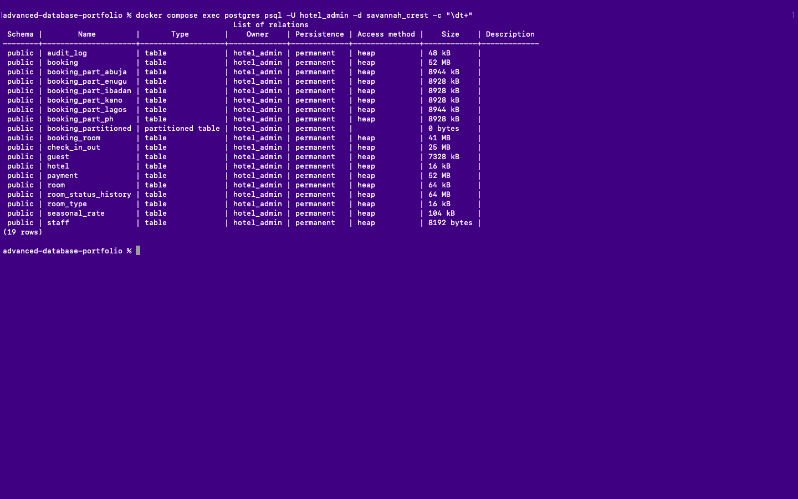
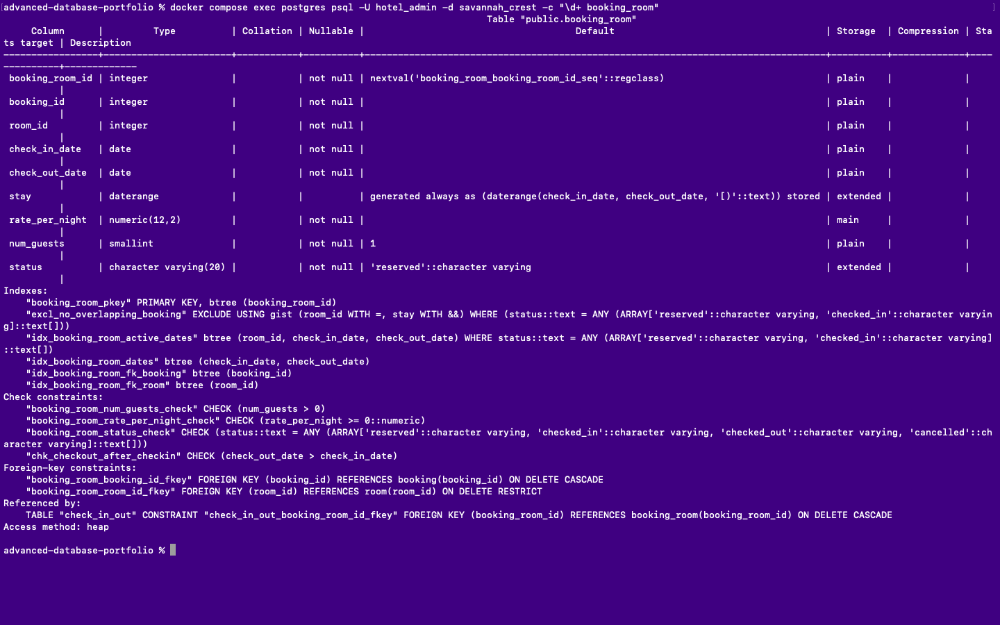
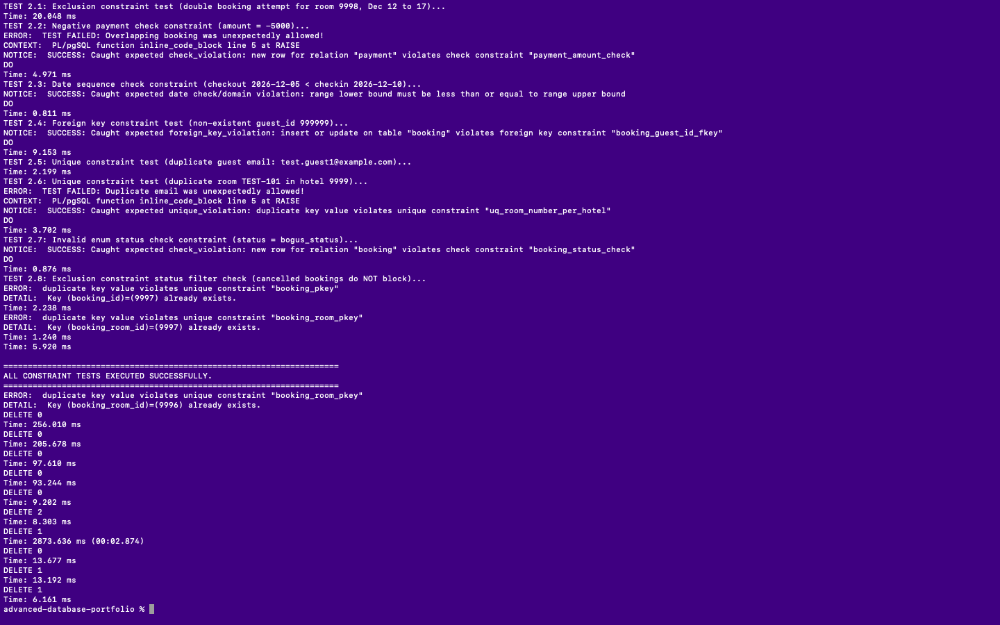

# Portfolio 1: Database Design and Modelling

**Course:** MIT 8103 Advanced Database Systems  
**Case Study:** Savannah Crest Hotels (Central Reservation and Property Management System)  
**Database Engine:** PostgreSQL 16  
**Status:** Completed  

---

## 1. Overview and Deliverables

Portfolio 1 implements the complete conceptual, logical, and physical database design for Savannah Crest Hotels across 6 properties in Nigeria (Abuja, Lagos, Port Harcourt, Kano, Enugu, Ibadan).

The deliverables comprise:
- **Requirements & Business Rules:** [docs/requirements.md](docs/requirements.md) (16 business rules, entity catalog, cardinalities, 10 core queries).
- **Entity-Relationship Diagram:** [docs/er-diagram.md](docs/er-diagram.md) (Mermaid ER diagram detailing PK/FK relationships and cardinalities).
- **Relational Schema DDL:** [sql/01_schema.sql](sql/01_schema.sql) (PostgreSQL 16 DDL with keys, constraints, generated daterange, exclusion constraint).
- **Views and Triggers:** [sql/02_views_and_triggers.sql](sql/02_views_and_triggers.sql) (Availability, occupancy, housekeeping status, audit trigger).
- **Normalisation Analysis:** [docs/normalisation.md](docs/normalisation.md) (Rigorous UNF -> 1NF -> 2NF -> 3NF/BCNF decomposition and denormalisation justifications).
- **Schema Overview:** [docs/schema-overview.md](docs/schema-overview.md) (Table-by-table specifications).
- **Constraint Test Suite:** [sql/03_constraint_tests.sql](sql/03_constraint_tests.sql) (Positive and negative test harness).
- **Empirical Evidence:** [evidence/](evidence/) (All real terminal outputs from psql: tables, descriptions, constraints, views, triggers, and test execution logs).
- **Screenshots Guide:** [screenshots/README.md](screenshots/README.md) (Instructions for assessor inspection captures).

---

## 2. Environment and How to Run

Ensure the PostgreSQL container is running:
```bash
make up
```

Apply the schema and views cleanly:
```bash
make p1
```

Run the constraint verification test suite and capture results:
```bash
docker compose exec -T postgres psql -U hotel_admin -d savannah_crest \
  < portfolio-1-database-design/sql/03_constraint_tests.sql \
  > portfolio-1-database-design/evidence/constraint-tests.txt 2>&1
```

Re-generate all table and constraint evidence dumps:
```bash
bash portfolio-1-database-design/evidence/capture_schema_evidence.sh
```

---

## 3. Advanced Concept: The GiST Exclusion Constraint

A core requirement in hotel management is the prevention of double bookings. Standard SQL primary and unique constraints can only enforce discrete equality on single columns or combinations (e.g., room 101 cannot be assigned twice with the same reservation ID). They cannot evaluate temporal range intersections ($[start_1, end_1) \cap [start_2, end_2) \neq \emptyset$).

In this design, double booking prevention is enforced at the database kernel level using PostgreSQL's generalized search tree (GiST) index with the `btree_gist` extension:

```sql
CONSTRAINT excl_no_overlapping_booking EXCLUDE USING gist (
    room_id WITH =,
    stay    WITH &&
) WHERE (status IN ('reserved', 'checked_in'))
```

### Explanatory notes:
- **`btree_gist` extension:** Standard GiST indexes do not support scalar integer equality (`=`). The extension provides GiST operator classes for standard B-tree types, enabling a single multi-column GiST index over `(room_id, stay)`.
- **`stay` daterange with `[)` bounds:** Check-in date is inclusive; check-out date is exclusive. If Guest A checks out on `2026-12-15` and Guest B checks in on `2026-12-15`, the ranges `[2026-12-10, 2026-12-15)` and `[2026-12-15, 2026-12-20)` do not intersect (`&&` evaluates to `FALSE`). This allows frictionless same-day turnaround.
- **Partial filter (`WHERE status IN ('reserved', 'checked_in')`):** When a booking is marked `cancelled` or `checked_out`, it stops competing for the room. A cancelled booking retains its row for audit without blocking future reservations for those dates.

---

## 4. Evidence Summary

| Deliverable | File Path | Description |
|---|---|---|
| Table Catalog | [evidence/table-list.txt](evidence/table-list.txt) | `\dt+` output confirming 12 tables in public schema |
| Constraint Catalog | [evidence/all-constraints.txt](evidence/all-constraints.txt) | All PK, FK, CHECK, and EXCLUSION constraints queried from `pg_constraint` |
| Views Catalog | [evidence/view-list.txt](evidence/view-list.txt) | `\dv+` output showing availability, occupancy, and status views |
| Triggers Catalog | [evidence/trigger-list.txt](evidence/trigger-list.txt) | Triggers on `booking`, `hotel`, and `guest` |
| Constraint Execution Log | [evidence/constraint-tests.txt](evidence/constraint-tests.txt) | Live terminal execution log proving rejection of overlapping dates, negative money, orphan FKs |
| Table Definitions | `evidence/desc-<table_name>.txt` | Detailed `\d+` schema descriptions for each table |

---

## 5. Visual Evidence & Screenshots

- **Schema Tables Overview (`p1-01-schema-tables.png`):**  
  Terminal output showing all 12 relation tables with their size and persistence.  
  

- **Exclusion Constraint Definition (`p1-02-exclusion-constraint.png`):**  
  Terminal output showing `booking_room` structure, the generated `stay` range, and the `excl_no_overlapping_booking` GiST constraint.  
  

- **Constraint Violation & Integrity Tests (`p1-03-constraint-violation-tests.png`):**  
  Terminal execution of `03_constraint_tests.sql` showing PostgreSQL rejecting overlapping reservations and negative payments.  
  
  
