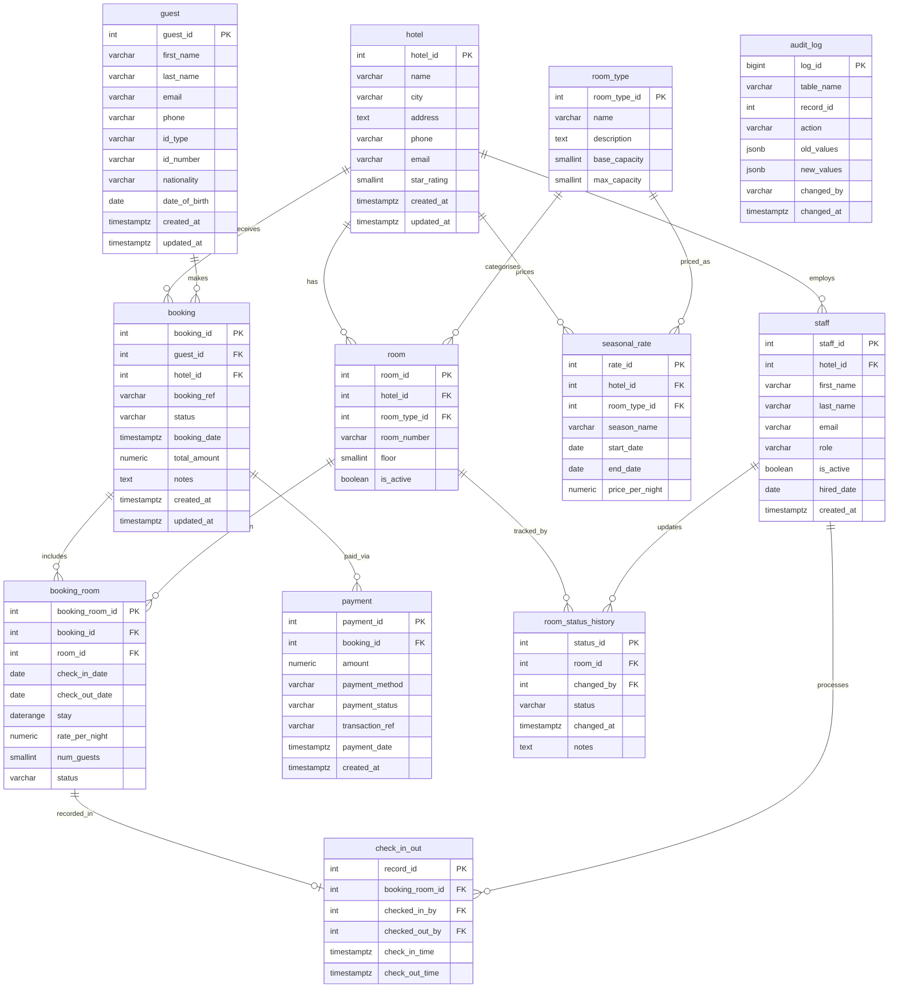

# Entity-Relationship Diagram: Savannah Crest Hotels

## ER Diagram



_If mermaid-cli is available, export to `diagrams/er-diagram.png` with:_
```bash
npx -p @mermaid-js/mermaid-cli mmdc -i docs/er-diagram.md -o diagrams/er-diagram.png -t neutral
```

## Modelling Decisions

### 1. Date range on booking_room, not on booking

A booking is a container for one or more room assignments. The actual stay dates (check-in date, check-out date) live on `booking_room`, not on `booking`. This allows a guest to book two rooms for different (possibly overlapping) date ranges in the same reservation. The `stay` column stores the same data as a PostgreSQL `daterange` for use in the exclusion constraint.

**Alternative rejected:** Putting dates on `booking` alone would force all rooms in a multi-room booking to share the same dates, which is unrealistic.

### 2. Price snapshotted onto booking_room

The `rate_per_night` on `booking_room` records the price agreed at booking time. Seasonal rates may change later, but the guest's confirmed rate does not. The `total_amount` on `booking` is a denormalised sum of (rate_per_night * nights) across all booking_rooms, updated when rooms are added/removed.

**Why this is acceptable denormalisation:** Without the snapshot, a rate change would retroactively alter the cost of existing bookings, which is a business logic error. The `total_amount` on booking avoids recomputing it for every invoice/report query.

### 3. booking_room as a junction table (multi-room bookings)

Rather than a simple 1:1 between booking and room, the `booking_room` junction table supports multi-room bookings. Each row represents one room for one date range within one booking, with its own snapshotted rate and status.

**Alternative rejected:** A 1:1 booking-to-room model would force a family to create separate bookings for each room, losing the grouping and complicating payment.

### 4. Separate check_in_out from booking_room

`booking_room` represents the reservation (the intent to stay). `check_in_out` records the physical event (actual arrival and departure times, which staff member processed it). A guest may reserve but never arrive (no_show), so `check_in_out` is optional (partial participation). Timestamps on check_in_out are `TIMESTAMPTZ` (actual moments), while dates on booking_room are `DATE` (calendar days).

### 5. room_status_history as a log, not a single status column

Housekeeping status changes over time (dirty after checkout, cleaned by housekeeping, inspected by supervisor). A history table lets us audit who cleaned what and when, rather than only knowing the current state. The current status is the most recent entry per room (queryable via a view or `DISTINCT ON`).

### 6. Generic audit_log with JSONB

The `audit_log` table stores before/after values as JSONB rather than having separate audit tables per entity. This keeps the schema simple while still capturing full change history. The trade-off is that JSONB queries are slower than typed columns, but audit queries are infrequent and analytical.

### 7. Exclusion constraint for double-booking prevention

PostgreSQL's `EXCLUDE USING gist` on `booking_room` prevents overlapping date ranges for the same room at the database level. This is stronger than application-level checks because it works even under concurrent transactions. Requires the `btree_gist` extension.

### 8. Enums via CHECK constraints, not CREATE TYPE

Status fields (booking status, payment status, room status, etc.) use `CHECK` constraints with explicit value lists rather than PostgreSQL `CREATE TYPE ... AS ENUM`. This makes it easier to add new values later (ALTER TABLE vs. ALTER TYPE) and keeps the schema self-documenting. The trade-off is slightly less type safety, but CHECK constraints are sufficient for this use case.

**Exception:** If the same set of values is used across multiple tables, a shared `CREATE TYPE` would be justified to avoid duplication. In this schema, each status domain is specific to its table, so CHECK constraints are preferred.

