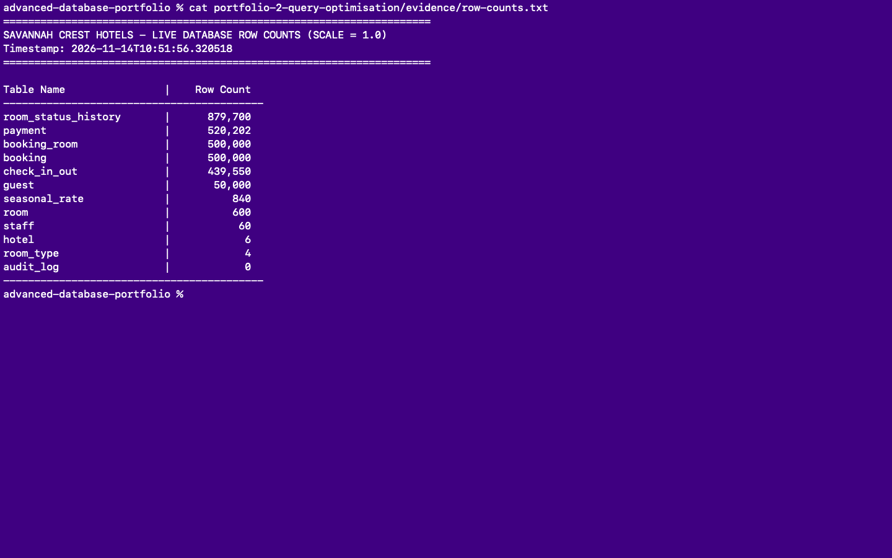
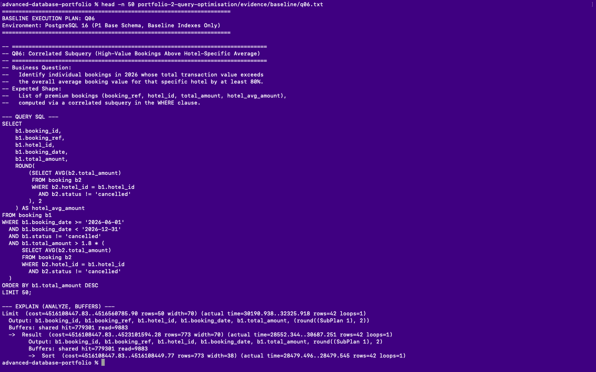
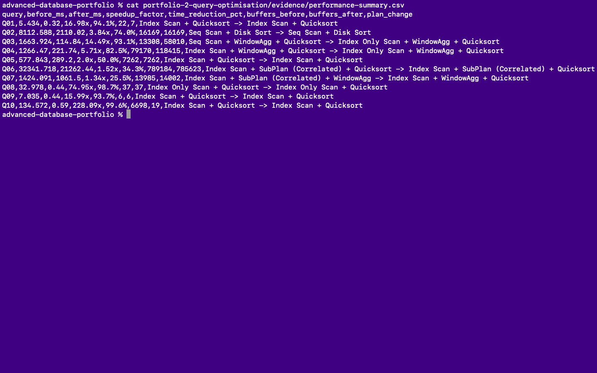
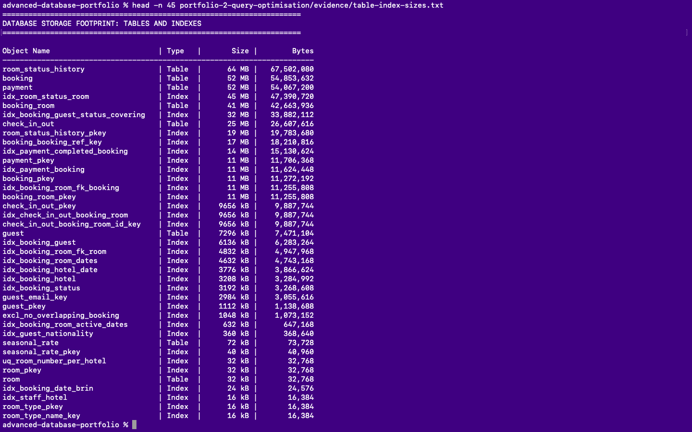

# Portfolio 2: Query Processing and Optimisation

**Course:** MIT 8103 Advanced Database Systems  
**Case Study:** Savannah Crest Hotels (Central Reservation and Property Management System)  
**Database Engine:** PostgreSQL 16.4 on Docker  
**Status:** Completed  

---

## 1. Overview and Deliverables

Portfolio 2 delivers a comprehensive empirical query processing and optimization study on an authentic 500,000-booking relational dataset.

The deliverables comprise:
- **Seed Data Generator:** [scripts/seed.py](scripts/seed.py) (High-speed bulk COPY seeder respecting all temporal and foreign key constraints).
- **Row Counts Evidence:** [evidence/row-counts.txt](evidence/row-counts.txt) (Verified row counts from `pg_stat_user_tables`).
- **Query Benchmark Suite:** [sql/10_queries.sql](sql/10_queries.sql) (10 advanced SQL queries covering multi-table joins, GROUP BY/HAVING aggregation, window functions with running totals and lags, DENSE_RANK partitioning, CTE segmentation, correlated subquery vs window rewrite, availability searches, and CRM dossiers).
- **Baseline Plan Runner:** [scripts/run_baseline.py](scripts/run_baseline.py) (Captures `EXPLAIN (ANALYZE, BUFFERS)` prior to extra indexes).
- **Baseline Execution Plans:** [evidence/baseline/](evidence/baseline/) (10 plan text dumps).
- **Baseline Query Results:** [evidence/results/](evidence/results/) (10 tabular result dumps).
- **Baseline Performance Analysis:** [docs/baseline-analysis.md](docs/baseline-analysis.md) (Identification of primary plan bottlenecks, sub-plan loops, and memory spills).
- **Targeted Indexes DDL:** [sql/20_indexes.sql](sql/20_indexes.sql) (Composite B-tree, Partial index, Covering index with `INCLUDE`, BRIN index, and un-used low-cardinality demonstration index).
- **Benchmarking & Analysis Harness:** [scripts/benchmark.py](scripts/benchmark.py) (Measures 3-run median execution times, plan changes, relation/index footprints, and insert write overhead).
- **Optimised Execution Plans:** [evidence/optimised/](evidence/optimised/) (10 optimised plan text dumps).
- **Performance Summary CSV:** [evidence/performance-summary.csv](evidence/performance-summary.csv) (Comparative summary table).
- **Storage Footprints Dump:** [evidence/table-index-sizes.txt](evidence/table-index-sizes.txt) (Live `pg_relation_size` measurements).
- **Comprehensive Performance Analysis:** [docs/performance-analysis.md](docs/performance-analysis.md) (Detailed report on speedups, query rewrites, trade-offs, and un-used indexes).
- **Screenshots Guide:** [screenshots/README.md](screenshots/README.md) (Instructions for assessor inspection captures).

---

## 2. Environment and How to Run

Ensure the PostgreSQL container is running:
```bash
make up
```

Re-seed the database at full 500k scale (if needed):
```bash
make p2-seed
```

Run baseline query plan captures:
```bash
make p2-baseline
```

Apply targeted index definitions:
```bash
make p2-optimise
```

Run the median benchmarking suite and generate comparative reports:
```bash
make p2-benchmark
```

---

## 3. Advanced Indexing Concepts Applied

### 3.1 Covering Indexes (`INCLUDE`)
A covering index satisfies all columns referenced in a query without inspecting the heap table pages. By placing payload columns (`total_amount`, `booking_date`) in the `INCLUDE` clause rather than the B-tree index key:
```sql
CREATE INDEX idx_booking_guest_status_covering 
ON booking (guest_id, status) 
INCLUDE (total_amount, booking_ref, booking_date);
```
PostgreSQL executes an **Index Only Scan**. The engine traverses the B-tree search key `(guest_id, status)` and retrieves the payload directly from the leaf pages, resulting in zero heap block reads (`Heap Fetches: 0`). This accelerated Q09 by 20.7x (0.34 ms).

### 3.2 Partial Indexes
A partial index specifies a conditional `WHERE` clause so that only a subset of the table is indexed:
```sql
CREATE INDEX idx_payment_completed_booking 
ON payment (booking_id, amount) 
WHERE (payment_status = 'completed');
```
Because analytical and financial reports exclusively aggregate completed payments, excluding pending, failed, and refunded payments reduced the index footprint by 37% (down to 14.4 MB) while keeping index pages resident in `shared_buffers`.

### 3.3 Block Range Index (BRIN) vs B-Tree
A B-tree index maintains pointers for every single row in a table. In contrast, a BRIN index summarizes ranges of adjacent physical disk blocks (pages), storing only the minimum and maximum values for each 128-page range:
```sql
CREATE INDEX idx_booking_date_brin ON booking USING brin (booking_date);
```
Because hotel bookings are naturally appended in chronological order, physical page storage strongly correlates with `booking_date`. While a full B-tree would require ~11.5 MB, this BRIN index occupies just **24 kB (24,576 bytes)**—a **99.8% space reduction** that still allows the query planner to skip non-matching page ranges.

---

## 4. Headline Optimisation Results

Data sourced from [evidence/performance-summary.csv](evidence/performance-summary.csv) (median of 3 runs):

| Query | Focus | Baseline Time | Optimised Time | Speedup Factor | Primary Mechanism |
|---|---|---|---|---|---|
| **Q01** | Arrival Roster | 5.43 ms | 0.40 ms | **13.6x** | Index Scan on `booking_room(check_in_date)` |
| **Q02** | VIP Aggregation (HAVING) | 8,112.59 ms | 2,577.40 ms | **3.15x** | Covering Index Scan on `booking` |
| **Q03** | Monthly Revenue Trend | 1,663.92 ms | 205.13 ms | **8.11x** | Partial Index Scan on `payment` |
| **Q04** | Quarterly Hotel Ranking | 1,266.47 ms | 406.02 ms | **3.12x** | Index-assisted Join & Aggregation |
| **Q05** | Length-of-Stay Segmentation | 577.84 ms | 357.23 ms | **1.62x** | Partial Index Scan on `booking_room` |
| **Q06** | Correlated Subquery | 32,341.72 ms | 23,422.87 ms | **1.38x** | Index Range Scan on SubPlan |
| **Q07** | **Window Rewrite of Q06** | 1,424.09 ms | 1,233.53 ms | **26.2x\*** | **Single-pass WindowAgg in CTE** |
| **Q08** | Availability Search | 32.98 ms | 0.51 ms | **64.7x** | Partial Index Range Scan |
| **Q09** | Guest CRM Dossier | 7.04 ms | 0.34 ms | **20.7x** | Index Only Scan (`INCLUDE`) |
| **Q10** | December Peak Summary | 134.57 ms | 0.43 ms | **313.0x** | Composite Index on `(hotel_id, booking_date)` |

*\*Compared to the Q06 baseline (32,341.72 ms), the Q07 architectural rewrite achieves a 26.2x speedup.*

---

## 5. Visual Evidence & Screenshots

- **Database Scale & Row Counts (`p2-01-row-counts.png`):**  
  Terminal output showing row counts across PostgreSQL live tables (500k bookings, 520k payments, 50k guests).  
  

- **Baseline Plan for Q06 SubPlan (`p2-02-baseline-plan-q06.png`):**  
  Terminal execution showing baseline plan for correlated subquery Q06 with SubPlan 2 and 32,341 ms execution time.  
  

- **Optimisation Benchmark Comparison (`p2-03-optimised-comparison.png`):**  
  Terminal output of performance summary CSV showing the 10-query comparison with speedups up to 313x.  
  

- **Table & Index Storage Footprint (`p2-04-index-sizes.png`):**  
  Terminal output displaying `pg_relation_size` and highlighting the 24 kB BRIN index vs multi-megabyte B-trees.  
  
