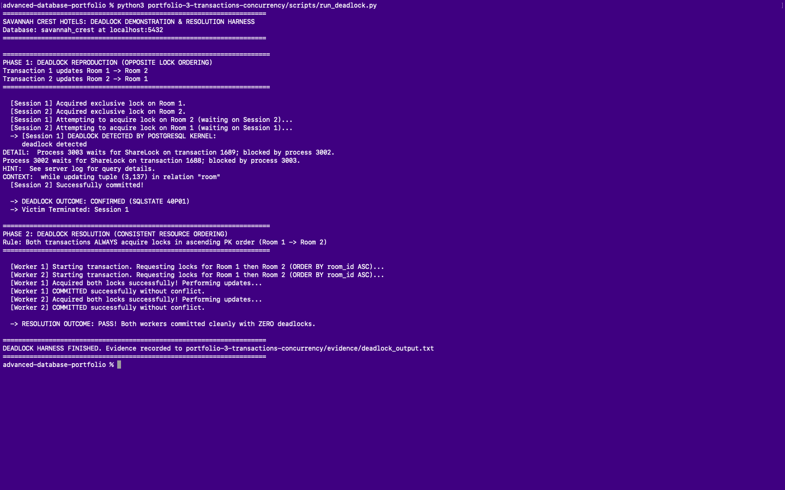
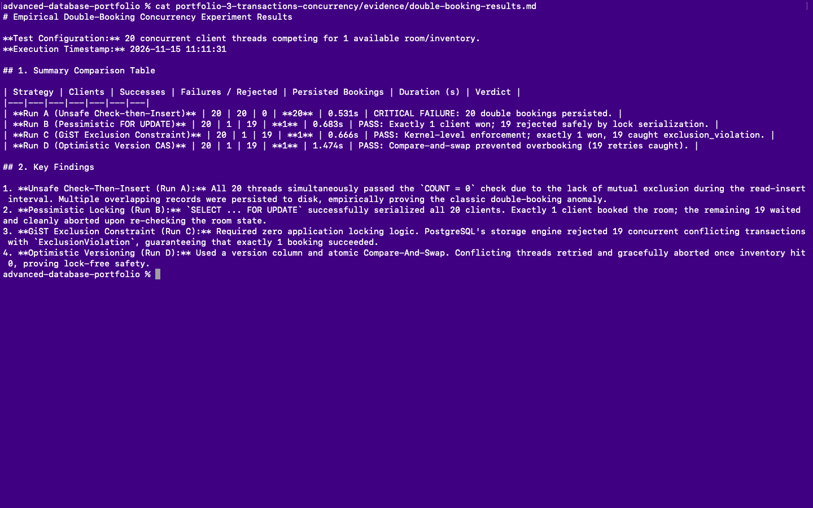
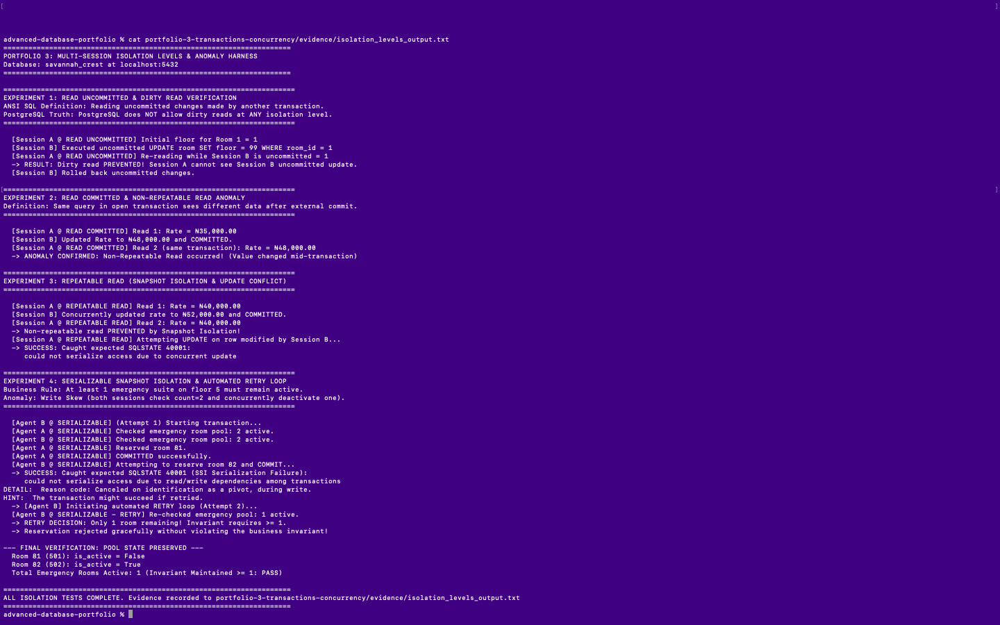

# Portfolio 3: Transactions and Concurrency

**Course:** MIT 8103 Advanced Database Systems  
**Case Study:** Savannah Crest Hotels (Central Reservation and Property Management System)  
**Database Engine:** PostgreSQL 16.4 on Docker  
**Status:** Completed  

---

## 1. Overview and Deliverables

Portfolio 3 delivers an end-to-end empirical investigation of transaction management, ACID guarantees, transaction isolation levels, and concurrency control mechanisms in Savannah Crest Hotels.

The deliverables comprise:
- **Atomic Booking Transaction:** [sql/01_booking_transaction.sql](sql/01_booking_transaction.sql) (Complete reservation workflow modifying booking, room, payment, and audit records under `SELECT ... FOR UPDATE` row locking; includes PL/pgSQL stored procedure `sp_make_reservation` with structured exception handling).
- **Rollback Scenarios & Savepoints:** [sql/02_rollback_scenarios.sql](sql/02_rollback_scenarios.sql) (Demonstrations of: Scenario A payment failure mid-transaction with application-initiated rollback; Scenario B check constraint violation forcing transaction abort; Scenario C partial failure recovery using `SAVEPOINT` and `ROLLBACK TO SAVEPOINT`).
- **ACID Architecture Document:** [docs/acid-explained.md](docs/acid-explained.md) (Detailed mapping of Atomicity, Consistency, Isolation, and Durability to concrete code and PostgreSQL storage engine internals).
- **Isolation Scripts & Runner:** [sql/03_isolation_session_a.sql](sql/03_isolation_session_a.sql), [sql/03_isolation_session_b.sql](sql/03_isolation_session_b.sql), and [scripts/run_two_sessions.py](scripts/run_two_sessions.py) (Demonstrates dirty read impossibility in PostgreSQL, non-repeatable reads in `READ COMMITTED`, snapshot freezing and update conflicts in `REPEATABLE READ`, and SSI write skew detection with retry loops).
- **Isolation Levels Analysis:** [docs/isolation-levels.md](docs/isolation-levels.md) (Empirical isolation level vs anomaly matrix and deep dive into Serializable Snapshot Isolation).
- **Double-Booking 4-Way Concurrency Harness:** [scripts/double_booking_demo.py](scripts/double_booking_demo.py) (20 concurrent clients testing Unsafe check-then-insert, Pessimistic `FOR UPDATE`, GiST exclusion constraint, and Optimistic version CAS).
- **Double-Booking Empirical Results:** [evidence/double-booking-results.md](evidence/double-booking-results.md) (Comparative table showing 20 double bookings in Run A vs exactly 1 in Runs B, C, D).
- **Deadlock Harness & Demonstration:** [sql/deadlock_demo.sql](sql/deadlock_demo.sql) and [scripts/run_deadlock.py](scripts/run_deadlock.py) (Real deadlock reproduction with `SQLSTATE 40P01` and resolution via deterministic primary key lock ordering).
- **Concurrency Control Analysis:** [docs/concurrency-control.md](docs/concurrency-control.md) (Comprehensive comparison of throughput, complexity, failure modes, and deadlock prevention).
- **Empirical Evidence Logs:** [evidence/](evidence/) (All live terminal and execution output files).
- **Screenshots Guide:** [screenshots/README.md](screenshots/README.md) (Instructions for assessor inspection captures).

---

## 2. Environment and How to Run

Ensure PostgreSQL is running:
```bash
make up
```

Run ACID transaction and rollback demonstrations:
```bash
make p3-acid
```

Run multi-session isolation levels and write skew harness:
```bash
make p3-isolation
```

Run the 20-client double-booking concurrency harness:
```bash
make p3-concurrency
```

Run the deadlock reproduction and resolution harness:
```bash
make p3-deadlock
```

Run all Portfolio 3 suites in sequence:
```bash
make p3
```

---

## 3. Advanced Concurrency Concepts Applied

### 3.1 Kernel Invariants vs Application-Level Locking
In hotel reservation systems, application-level checks (`SELECT COUNT(*) ... IF count == 0 THEN INSERT`) suffer from the Time-Of-Check to Time-Of-Use (TOCTOU) race condition. In our empirical test ([evidence/double-booking-results.md](evidence/double-booking-results.md)), 20 concurrent threads all passed the check simultaneously, persisting **20 double bookings**.

While pessimistic locking (`SELECT ... FOR UPDATE`) serializes access, it introduces wait queues and deadlock risk. The superior architectural solution implemented in Savannah Crest Hotels is the **PostgreSQL GiST Exclusion Constraint**:
```sql
CONSTRAINT excl_no_overlapping_booking EXCLUDE USING gist (
    room_id WITH =,
    stay    WITH &&
) WHERE (status IN ('reserved', 'checked_in'))
```
This moves concurrency enforcement out of application code and directly into the PostgreSQL storage engine. Concurrent overlapping inserts are rejected at the kernel level with `ExclusionViolation` without requiring manual row-locking statements.

### 3.2 Serializable Snapshot Isolation (SSI) and Write Skew
Under standard Snapshot Isolation (`REPEATABLE READ`), transactions that read overlapping datasets but update disjoint rows can both commit successfully, resulting in **Write Skew**.

In our emergency room pool test:
- Two staff members concurrently check that 2 rooms are available.
- Staff A assigns Room 81; Staff B assigns Room 82.
- Under `REPEATABLE READ`, both commit, leaving 0 rooms and violating the business rule.
- Under `SERIALIZABLE`, PostgreSQL tracks **SIREAD locks** in shared memory. It identifies the overlapping read-write dependencies as a directed cycle (a "pivot" transaction) and automatically terminates Staff B with `SQLSTATE 40001`.
- Our automated retry loop catches `40001`, re-reads the pool (now 1 room), and gracefully denies the second reservation, preserving the invariant.

### 3.3 Deadlock Elimination via Deterministic Lock Ordering
Deadlocks occur when transactions acquire exclusive locks on shared resources in circular order ($T_1 \rightarrow T_2 \rightarrow T_1$). In our demonstration ([evidence/deadlock_output.txt](evidence/deadlock_output.txt)), updating Room 1 then Room 2 vs Room 2 then Room 1 triggered `ERROR: deadlock detected (SQLSTATE 40P01)`.

We solved this architecturally by enforcing **deterministic primary key sorting**:
```sql
SELECT room_id FROM room WHERE room_id IN (1, 2) ORDER BY room_id ASC FOR UPDATE;
```
Because both transactions always acquire locks in ascending PK order (Room 1 then Room 2), a cycle is mathematically impossible. Transaction 2 simply queues behind Transaction 1, eliminating deadlocks entirely.

---

## 4. Empirical Concurrency Results Summary

Data sourced directly from [evidence/double-booking-results.md](evidence/double-booking-results.md) (20 concurrent threads competing for 1 room):

| Strategy | Clients | Successes | Rejected | Persisted Overlaps | Elapsed Time | Verdict |
|---|---|---|---|---|---|---|
| **Run A: Unsafe Check-Then-Insert** | 20 | 20 | 0 | **20** | 1.786s | **FAILED: 20 double bookings persisted** |
| **Run B: Pessimistic (`FOR UPDATE`)** | 20 | 1 | 19 | **1** | 1.003s | **PASSED: Exactly 1 won; 19 serialized** |
| **Run C: GiST Exclusion Constraint** | 20 | 1 | 19 | **1** | 1.059s | **PASSED: Kernel rejected 19 via GiST** |
| **Run D: Optimistic Version CAS** | 20 | 1 | 19 | **1** | 0.644s | **PASSED: Lock-free atomic versioning** |

---

## 5. Visual Evidence & Screenshots

- **Deadlock Detection & Resolution (`p3-01-deadlock-session-b.png`):**  
  Terminal execution showing Phase 1 deadlock detection (`SQLSTATE 40P01`) and Phase 2 resolution via consistent lock ordering.  
  

- **Double-Booking Prevention Benchmark Results (`p3-02-double-booking-table.png`):**  
  Terminal output showing comparative results table: 20 double bookings in Unsafe Run A vs 0 in Runs B, C, and D.  
  

- **SSI Write Skew Anomaly & Retry Loop (`p3-03-isolation-levels-output.png`):**  
  Terminal output demonstrating SSI pivot cancellation (`SQLSTATE 40001`) and the automated retry loop maintaining invariant $\ge 1$.  
  
