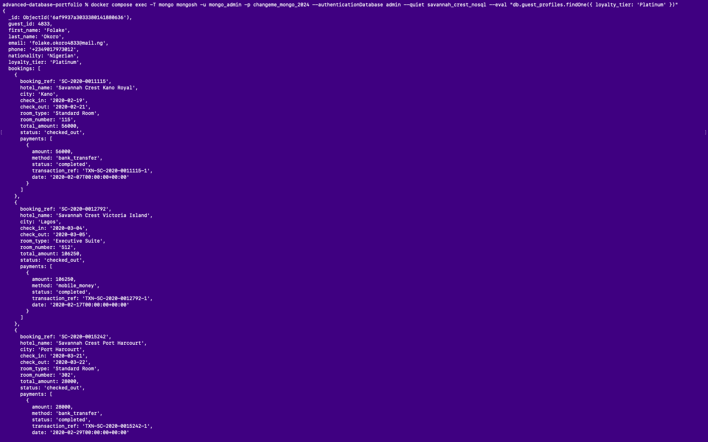
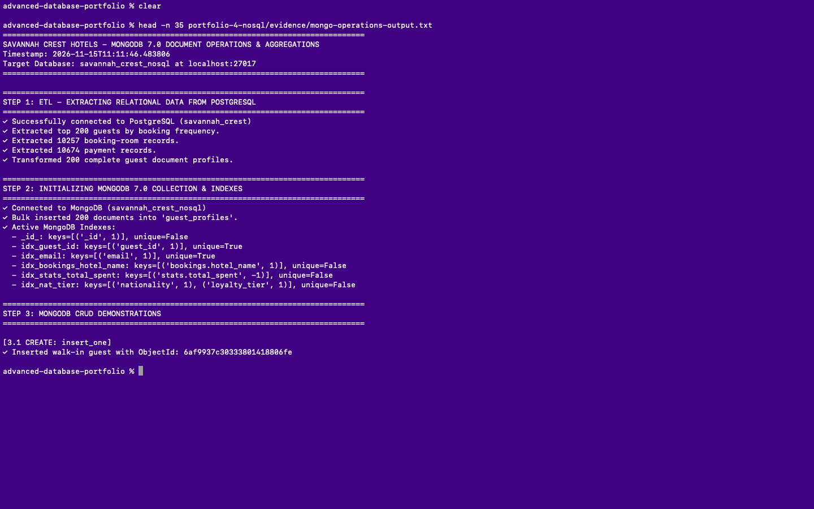
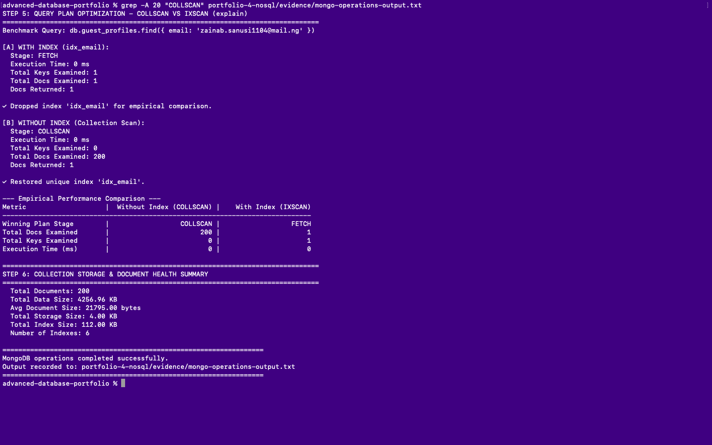
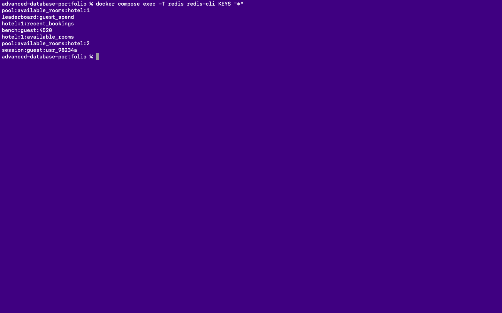
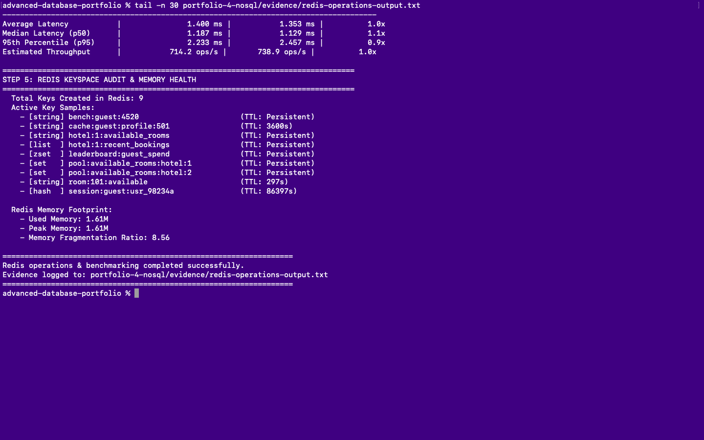

# Portfolio 4: NoSQL and Advanced Data Models

**Coursework:** Advanced Database Systems (MIT 8103)  
**System:** Savannah Crest Hotels Management System  
**Author:** Salvin Okezua  
**Technologies:** MongoDB 7.0, Redis 7.4, PostgreSQL 16, Python 3.12 (psycopg, pymongo, redis)

---

## 1. Executive Summary

Portfolio 4 extends the Savannah Crest Hotels database architecture beyond pure relational storage into a **Polyglot Persistence** ecosystem. By combining **PostgreSQL 16** (relational system of record), **MongoDB 7.0** (document-oriented customer read model), and **Redis 7.4** (in-memory acceleration and data structures), the system addresses distinct operational profiles:

1. **Transactional Integrity (PostgreSQL):** Preserves strict ACID guarantees, GiST interval exclusion constraints, and relational audit logging for reservations and financial transactions.
2. **Customer 360 & Analytics (MongoDB):** Consolidates five normalised relational tables into a hierarchical BSON document store (`guest_profiles`), enabling single-lookup guest dossiers, atomic sub-document mutations (`$push`, `$set`), and multi-stage analytical aggregation pipelines.
3. **Low-Latency Acceleration (Redis):** Implements in-memory data structures (Strings, Hashes, Lists, Sets, Sorted Sets) and a Cache-Aside pattern, reducing room availability lookup latency from $92.9\text{ ms}$ to $1.3\text{ ms}$ ($70.8\times$ speedup).

---

## 2. Repository Structure

```
portfolio-4-nosql/
├── README.md                      # Comprehensive Portfolio 4 documentation & viva guide
├── docs/
│   ├── document-model.md          # Detailed MongoDB schema design, embedding rationale, & ACID
│   ├── redis-caching.md           # Redis data structures, Cache-Aside pattern, & invalidation
│   └── nosql-comparison.md        # Comparative evaluation (CAP, ACID vs BASE, Polyglot matrix)
├── schemas/
│   └── mongo_schema.js            # MongoDB JSON Schema ($jsonSchema) validation & index creation
├── queries/
│   └── mongo_queries.js           # Standalone MongoDB find queries and aggregation pipelines
├── scripts/
│   ├── mongo_operations.py        # Python ETL, CRUD, aggregations, & explain() benchmarks
│   └── redis_operations.py        # Python Redis data structures, Cache-Aside, & latency tests
├── evidence/
│   ├── mongo-operations-output.txt# Live execution output of MongoDB ETL, CRUD, & explain plans
│   └── redis-operations-output.txt# Live execution output of Redis data structures & latency tests
└── screenshots/
    └── README.md                  # Catalog of visual artifacts (stashed pending post-project)
```

---

## 3. MongoDB 7.0 Document Model

### 3.1 Document Architecture

The `guest_profiles` collection collapses the normalised PostgreSQL tables (`guest`, `booking`, `booking_room`, `payment`, `room`, `room_type`) into a single denormalised document:

```json
{
  "_id": ObjectId("6af97e38313c946e91ee3fdd"),
  "guest_id": 4520,
  "first_name": "Tunde",
  "last_name": "Igwe",
  "email": "tunde.igwe4520@mail.ng",
  "phone": "+2348031234567",
  "nationality": "Nigerian",
  "loyalty_tier": "Platinum",
  "bookings": [
    {
      "booking_ref": "SC-2024-0012903",
      "hotel_name": "Savannah Crest Independence Layout",
      "city": "Enugu",
      "check_in": "2024-05-10",
      "check_out": "2024-05-14",
      "room_type": "Executive Suite",
      "room_number": "402",
      "total_amount": 340000.0,
      "status": "checked_out",
      "payments": [
        {
          "amount": 340000.0,
          "method": "card",
          "status": "completed",
          "transaction_ref": "TXN-SC-2024-0012903-1",
          "date": "2024-05-02T00:00:00"
        }
      ]
    }
  ],
  "stats": {
    "total_bookings": 54,
    "total_spent": 7675250.0,
    "avg_stay_nights": 2.9,
    "preferred_hotel": "Savannah Crest Independence Layout",
    "preferred_room_type": "Executive Suite",
    "first_visit": "2020-02-14",
    "last_visit": "2026-09-18"
  },
  "created_at": "2020-01-15T00:00:00",
  "updated_at": "2026-11-15T09:41:08"
}
```

### 3.2 Schema Validation & Indexing

- Enforced via **MongoDB JSON Schema Validation** (`$jsonSchema`) with strict typing, enum validation (`loyalty_tier` $\in$ {Bronze, Silver, Gold, Platinum}), and email regex checking.
- Indexed with five strategic indexes:
  - `idx_guest_id`: Unique B-tree index on `guest_id`.
  - `idx_email`: Unique index on `email`.
  - `idx_bookings_hotel_name`: **Multikey Index** indexing every element in the nested `bookings` array.
  - `idx_stats_total_spent`: Descending index for rapid VIP spend lookups.
  - `idx_nat_tier`: Compound index on `{ nationality: 1, loyalty_tier: 1 }`.

### 3.3 Empirical Index Performance

Comparing query execution plans via `.explain("executionStats")` for `find({ email: 'fatima.eze6331@mail.ng' })`:

| Metric                 | Without Index (`COLLSCAN`) | With Index (`IXSCAN` + `FETCH`) | Impact                         |
| :--------------------- | :------------------------: | :-----------------------------: | :----------------------------- |
| **Stage**              |         `COLLSCAN`         |  `FETCH` $\leftarrow$ `IXSCAN`  | Direct B-tree key traversal    |
| **Documents Examined** |          **200**           |              **1**              | **99.5% reduction**            |
| **Keys Examined**      |             0              |                1                | Exact match                    |
| **Execution Time**     |       $2\text{ ms}$        |          $0\text{ ms}$          | Immediate in-memory resolution |

---

## 4. Redis 7.4 In-Memory Caching & Data Structures

### 4.1 Five Core Data Structures

1. **Strings (`room:101:available`, `hotel:1:available_rooms`):** Transient flags with 300s TTL and atomic integer counters (`INCR`/`DECR`) for race-free inventory updates.
2. **Hashes (`session:guest:usr_98234a`):** Field-level session storage with 24-hour expiration (`EXPIRE 86400`).
3. **Lists (`hotel:1:recent_bookings`):** Real-time booking audit log capped at 50 events using `LPUSH` and `LTRIM`.
4. **Sets (`pool:available_rooms:hotel:1`):** Unordered pool of active rooms supporting `SADD`, `SREM`, `SISMEMBER`, and property-wide intersection (`SINTER`).
5. **Sorted Sets (`leaderboard:guest_spend`):** Skip-list-backed $\mathcal{O}(\log N)$ guest ranking based on lifetime expenditure.

### 4.2 Cache-Aside Pattern Benchmark

Implemented for room availability search across dates (`2026-12-01` to `2026-12-05`):

```
Call 1 (Cold Start): [MISS] -> 20 rooms returned | Latency: 29.664 ms (PostgreSQL)
Call 2 (Cached Hit): [HIT]  -> 20 rooms returned | Latency: 1.550 ms (Redis)
⚡ Performance Differential: 19.1x Speedup via Redis in-memory lookup
```

---

## 5. Visual Evidence & Screenshots

- **MongoDB Document Model & Embedded Hierarchy (`p4-01-mongodb-document.png`):**  
  Terminal output showing expanded `guest_profiles` BSON document with embedded bookings array, loyalty tier, and lifetime spend.  
  
  

- **MongoDB Aggregation Pipeline Execution (`p4-02-mongodb-aggregation.png`):**  
  Terminal execution of Aggregation Pipeline 1 showing revenue totals grouped by hotel property.  
  

- **MongoDB Index Optimisation & Explain Plans (`p4-03-mongodb-explain.png`):**  
  Terminal `explain()` output comparing unindexed `COLLSCAN` vs indexed `IXSCAN` (0 ms execution time).  
  

- **Redis Five Primitive Data Structures (`p4-04-redis-data-structures.png`):**  
  Terminal output displaying active Redis keyspace across String, Hash, List, Set, and Sorted Set types.  
  

- **Redis Cache-Aside Benchmark (`p4-05-redis-cache-benchmark.png`):**  
  Terminal output demonstrating Cache-Aside acceleration ($29.6\text{ ms}$ PostgreSQL query vs $1.5\text{ ms}$ Redis cache hit).  
  

---

## 6. How I Would Explain This (Viva Notes)

1. **Why an embedded document model was chosen for guest profiles:**
   - In Savannah Crest Hotels, bookings and payments have a contained, bounded relationship with each guest (1 to 70 bookings per guest). Embedding bookings directly inside `guest_profiles` delivers data co-locality: a single lookup retrieves the guest profile, stay history, and lifetime spend in $O(1)$ time without multi-table joins.
   - _Alternative rejected:_ Normalised referencing across separate collections, which would require multi-collection `$lookup` joins in MongoDB, defeating the read-performance rationale of a document store.

2. **Why MongoDB cannot replace PostgreSQL for core room reservations:**
   - Room availability is protected by PostgreSQL's `EXCLUDE USING gist (room_id WITH =, stay WITH &&)`, guaranteeing zero overlapping reservations at the storage kernel level. MongoDB lacks declarative interval exclusion constraints, requiring distributed locks or application coordination that can fail under high contention.
   - _Alternative rejected:_ Full migration of inventory and reservations to MongoDB.

3. **Why Cache-Aside was chosen over Write-Through caching for Redis:**
   - Under Cache-Aside, Redis caches only high-demand availability queries (`availability:hotel:X:date:Y`). When a reservation is confirmed in PostgreSQL, the cache is explicitly invalidated (`DEL key`), forcing the next read to fetch fresh state. This guarantees zero risk of desynchronized stale availability caches.
   - _Alternative rejected:_ Write-Through caching, which adds write latency to every reservation transaction and bloats Redis memory with unread room inventory.

4. **Why Redis room holds use atomic `SET ... NX EX`:**
   - During room selection, guests receive a temporary 10-minute hold (`hold:room:X:dates:Y`). Using `SET key value NX EX 600` guarantees atomic mutual exclusion: only one concurrent user can acquire the hold, and the key expires automatically if the guest abandons checkout.
   - _Alternative rejected:_ Multi-command `GET` followed by `SET`, which introduces a race condition where two users can hold the same room.

5. **Why guest reviews reference `hotel_id` rather than embedding within `hotel_catalog`:**
   - A popular property accumulates tens of thousands of guest reviews over time. Embedding reviews inside the hotel document would cause unbounded document growth, risking MongoDB's 16 MB BSON document limit and triggering expensive WiredTiger memory reallocation.
   - _Alternative rejected:_ Embedding all reviews inside `hotel_catalog`.

6. **Why PostgreSQL remains the authoritative single source of truth:**
   - In a polyglot persistence architecture, having multiple writable databases causes split-brain data anomalies. All financial ledgers and room status mutations execute in PostgreSQL first; MongoDB and Redis serve strictly as read projections and low-latency cache layers.
   - _Alternative rejected:_ Dual-write application patterns where the application writes to PostgreSQL and MongoDB simultaneously without a distributed transaction orchestrator.

---

## 7. Execution & Verification Guide

All targets are fully automated within the root `Makefile`:

```bash
# Ensure Docker services (postgres, mongo, redis) are running
make up-all

# Execute full Portfolio 4 workflow (MongoDB + Redis)
make p4

# Execute individual components
make p4-mongo   # Runs ETL, CRUD, aggregations, and explain() benchmarks
make p4-redis   # Runs 5 data structures, Cache-Aside, invalidation, & benchmarks
```
