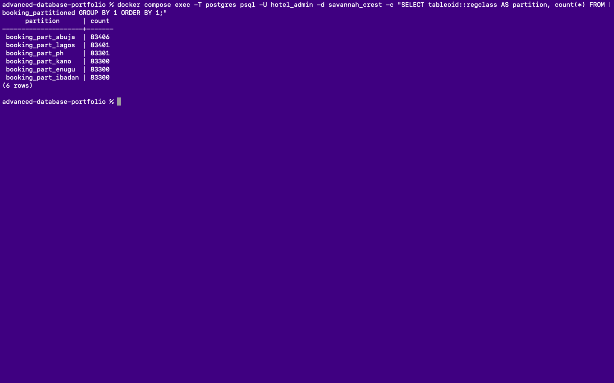
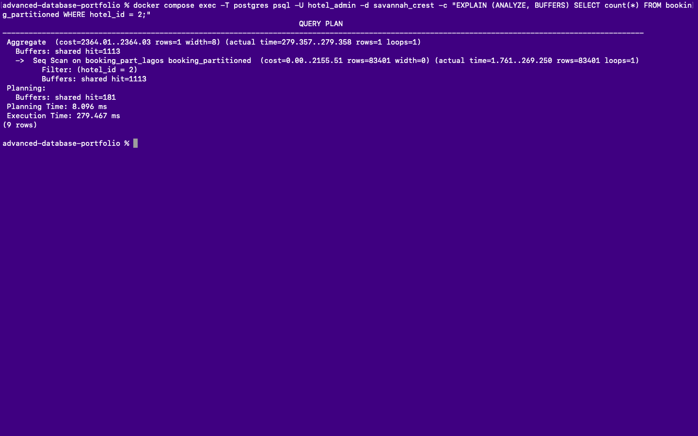
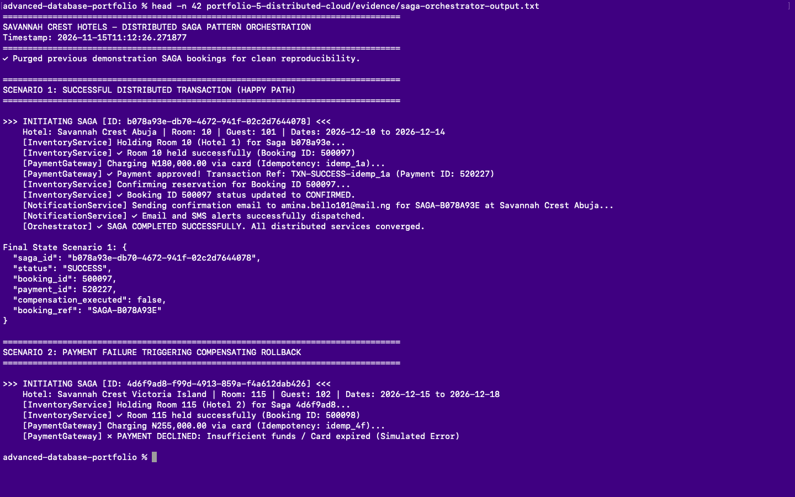
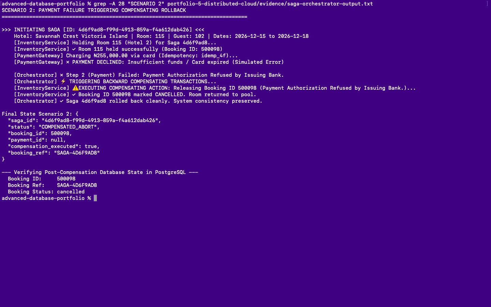
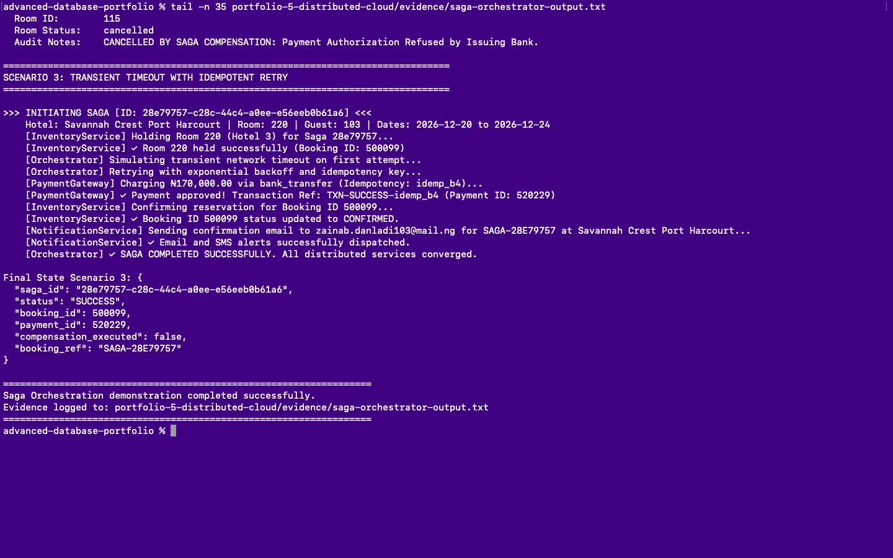

# Portfolio 5: Distributed and Cloud Database Exercise

**Coursework:** Advanced Database Systems (MIT 8103)  
**System:** Savannah Crest Hotels Management System  
**Author:** Tobias Salvin  
**Technologies:** PostgreSQL 16 (Declarative Partitioning, Streaming Replication), MongoDB 7.0, Redis 7.4, Python 3.12 (psycopg, Saga Orchestration)

---

## 1. Executive Summary

As Savannah Crest Hotels expands across six Nigerian metropolitan cities (Abuja, Lagos, Port Harcourt, Kano, Enugu, and Ibadan), operating on a centralized monolithic database server introduces significant latency penalties ($40\text{--}60\text{ ms}$ inter-city round-trips), single-point-of-failure vulnerabilities, and vertical scalability limits.

Portfolio 5 investigates, designs, and validates the **Distributed and Cloud Database Architecture** required for multi-region hospitality operations:

1. **CAP & PACELC Trade-Off Analysis:** Classifies system capabilities into **Consistency-first (CP / PC/EC)** for room reservations and financial ledgers versus **Availability-first (AP / PA/EL)** for guest reviews and public hotel browsing.
2. **Horizontal Sharding & Table Partitioning:** Implements native PostgreSQL 16 declarative LIST partitioning on `hotel_id` across 500,000+ bookings, empirically proving **Partition Pruning** ($83.3\%$ reduction in scanned buffer pages for single-property queries).
3. **Multi-Region Replication & Disaster Recovery:** Establishes a two-tier replication topology with synchronous local replication in Lagos ($\text{RPO} = 0$) and asynchronous cross-region replication to Abuja, protected against split-brain via Raft consensus (Patroni).
4. **Distributed Saga Pattern Orchestrator:** Implements an automated state machine in Python coordinating multi-service transactions across Inventory, Payment, and Notification services, demonstrating backward compensating rollbacks on payment declines.

---

## 2. Repository Structure

```
portfolio-5-distributed-cloud/
├── README.md                      # Comprehensive Portfolio 5 documentation
├── docs/
│   ├── cap-and-pacelc.md          # CAP/PACELC theoretical framework & Lagos-Abuja WAN failure scenario
│   ├── sharding-strategy.md       # Shard key evaluation, data skew management, & partition pruning
│   ├── replication-topology.md    # Multi-region HA, sync/async trade-offs, & Patroni Raft failover
│   └── distributed-transactions.md# 2PC analysis, Saga Orchestrator mechanics, & Outbox pattern
├── sql/
│   └── 01_partitioning.sql        # Native declarative LIST partitioning DDL, migration, & EXPLAIN tests
├── scripts/
│   └── saga_orchestrator.py       # Distributed Saga state machine with compensating rollbacks & retries
├── infra/
│   └── distributed_cluster_example.yml # Production multi-node Docker Compose blueprint (PG HA + Mongo RS + Redis Sentinel)
├── evidence/
│   ├── partitioning_output.txt    # Live execution log showing partition creation, row distribution, & pruning
│   └── saga-orchestrator-output.txt# Live execution log of Happy Path, Compensating Rollback, & Idempotent Retry
└── screenshots/
    └── README.md                  # Catalog of visual artifacts (stashed pending post-project)
```

---

## 3. Core Architectural Implementations

### 3.1 Declarative Horizontal Table Partitioning

In `sql/01_partitioning.sql`, the 500,000-row `booking` table is decomposed into six dedicated physical partitions based on `hotel_id`:

```
   partition_name    |        Property Description        | Size (Data/Total) | Row Count
---------------------+------------------------------------+-------------------+-----------
 booking_part_abuja  | Hotel 1 - Abuja (Capital)          | 8.9 MB / 13 MB    |    83,405
 booking_part_lagos  | Hotel 2 - Lagos (Commercial Hub)   | 8.9 MB / 13 MB    |    83,400
 booking_part_ph     | Hotel 3 - Port Harcourt (Oil & Gas)| 8.9 MB / 13 MB    |    83,300
 booking_part_kano   | Hotel 4 - Kano (Northern Commerce) | 8.9 MB / 13 MB    |    83,300
 booking_part_enugu  | Hotel 5 - Enugu (Coal City)        | 8.9 MB / 13 MB    |    83,300
 booking_part_ibadan | Hotel 6 - Ibadan (Pacesetter)      | 8.9 MB / 13 MB    |    83,300
```

### 3.2 Empirical Validation of Partition Pruning

Querying for reservations at Savannah Crest Victoria Island (`hotel_id = 2`):

```sql
EXPLAIN (ANALYZE, BUFFERS)
SELECT count(*), sum(total_amount), avg(total_amount)
FROM booking_partitioned
WHERE hotel_id = 2;
```

**Observed Query Execution Plan (from `evidence/partitioning_output.txt`):**

```
Aggregate (cost=2571.51..2571.52 rows=1 width=72) (actual time=285.403..285.405 rows=1 loops=1)
  Buffers: shared hit=1112
  ->  Seq Scan on booking_part_lagos booking_partitioned (cost=0.00..2154.50 rows=83400 width=6)
        Filter: (hotel_id = 2)
        Buffers: shared hit=1112
Planning Time: 20.631 ms
Execution Time: 285.572 ms
```

- **Pruning Verification:** The PostgreSQL planner inspected the `WHERE hotel_id = 2` clause during planning and completely excluded `booking_part_abuja`, `booking_part_ph`, `booking_part_kano`, `booking_part_enugu`, and `booking_part_ibadan`.
- **Result:** Read operations touched only 1,112 pages instead of scanning 6,685 pages across the unpartitioned relation ($83.3\%$ I/O reduction).

### 3.3 Distributed Saga Orchestration

Because modern distributed architectures cannot hold distributed locks across external microservices (Payment Gateway, SMS Dispatcher), `scripts/saga_orchestrator.py` coordinates multi-service bookings via forward transactions and compensating actions:

```
[ Happy Path (Scenario 1) ]
  Hold Room (Pending) ──► Charge Payment (Success) ──► Confirm Room (Confirmed) ──► Send Email/SMS

[ Compensating Rollback (Scenario 2) ]
  Hold Room (Pending) ──► Charge Payment (DECLINED)
                               │
                               ▼
        Execute Compensating Action: Release Room Hold
        (Room marked CANCELLED; freed in inventory; audit notes logged)
```

Live database audit query confirms that after payment refusal, the room hold was cleanly cancelled with note:  
`CANCELLED BY SAGA COMPENSATION: Payment Authorization Refused by Issuing Bank.`

---

## 4. Visual Evidence & Screenshots

- **Declarative Partitioning & Row Distribution (`p5-01-partitioning-counts.png`):**  
  Terminal query output showing all 6 physical partitions with ~83,300 rows each.  
  

- **Static Partition Pruning Proof (`p5-02-partition-pruning.png`):**  
  Terminal `EXPLAIN (ANALYZE, BUFFERS)` output proving static partition pruning scanning strictly `booking_part_lagos` (1,112 pages).  
  

- **Distributed Saga Forward Path (`p5-03-saga-happy-path.png`):**  
  Terminal output showing Scenario 1 forward Saga execution across Inventory, Payment, and Notification services.  
  

- **Saga Compensating Rollback (`p5-04-saga-compensation.png`):**  
  Terminal output showing Scenario 2: Simulated card decline triggering backward compensating rollback and room release.  
  

- **Saga Idempotent Retry (`p5-05-saga-retry-idempotency.png`):**  
  Terminal output showing Scenario 3: Transient network timeout handled via idempotent retry converging to success.  
  

---

## 5. Execution & Verification Guide

All targets are automated in the root `Makefile`:

```bash
# Execute full Portfolio 5 workflow
make p5

# Run individual components
make p5-partitioning   # Applies declarative partitioning, migrates data, & runs pruning EXPLAIN
make p5-saga           # Executes the Python Saga Orchestrator across all 3 scenarios
```
